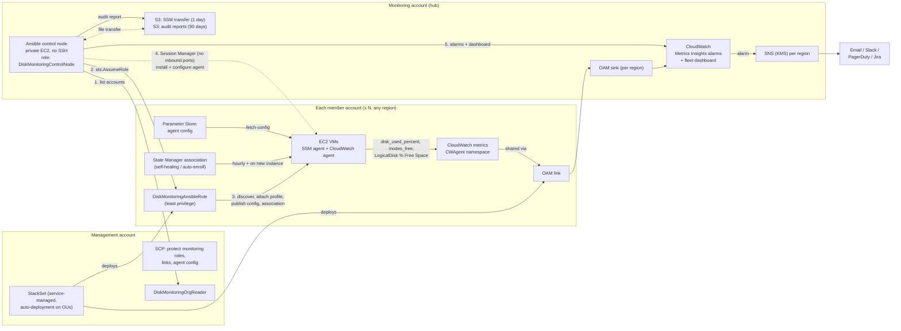
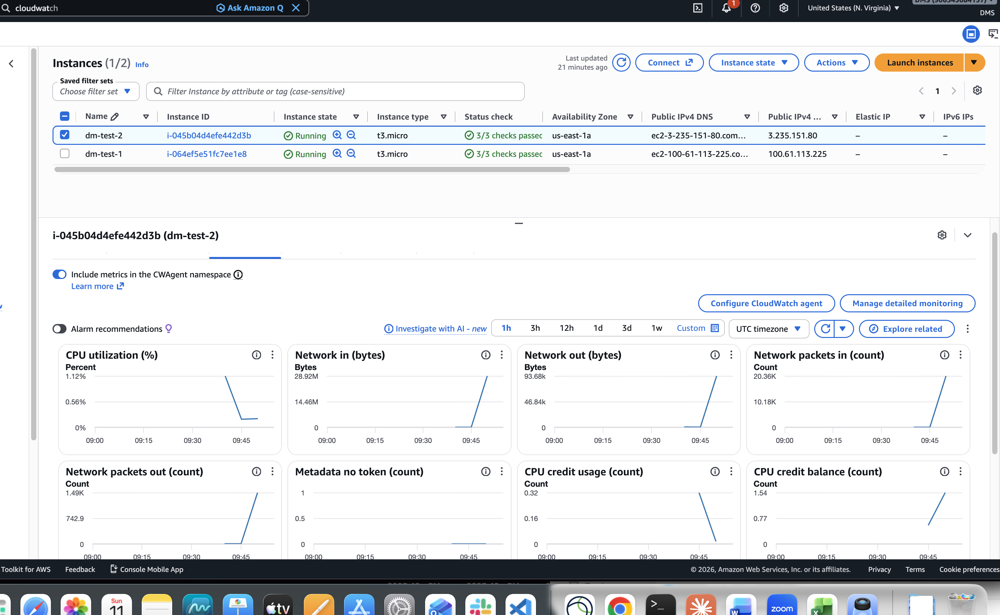
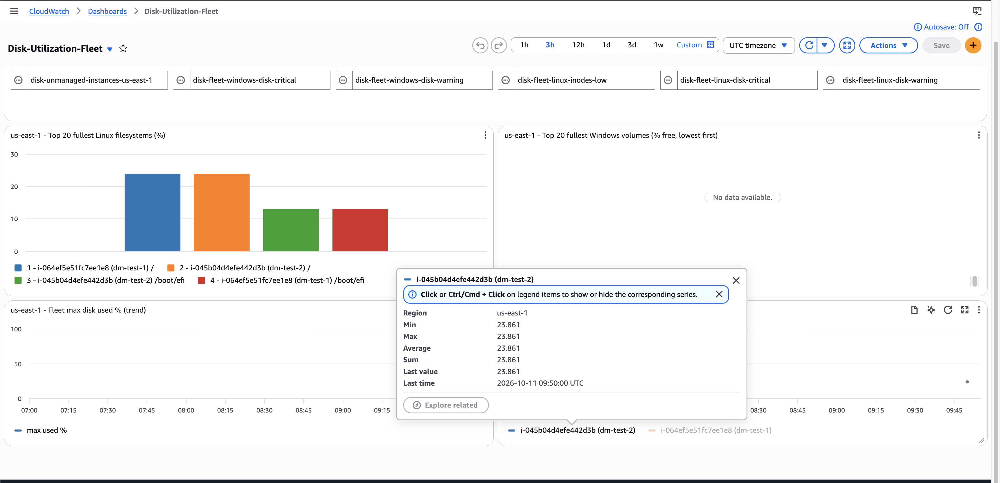
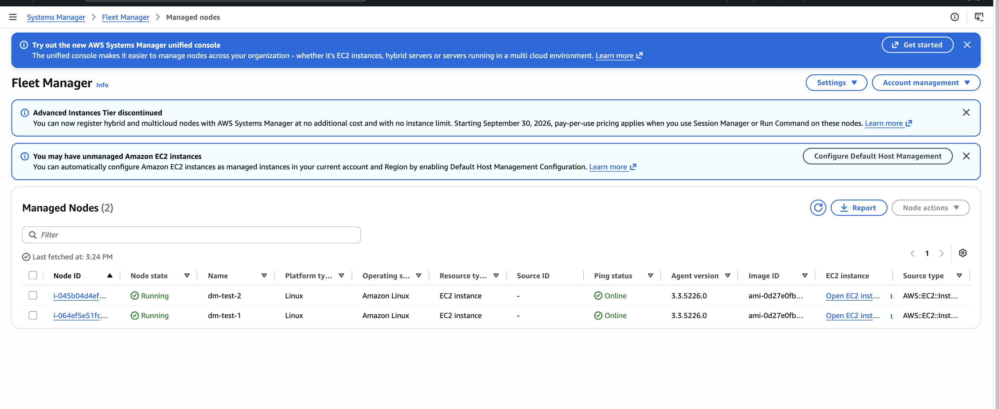
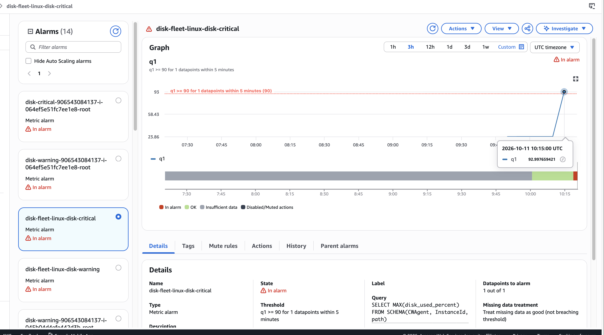
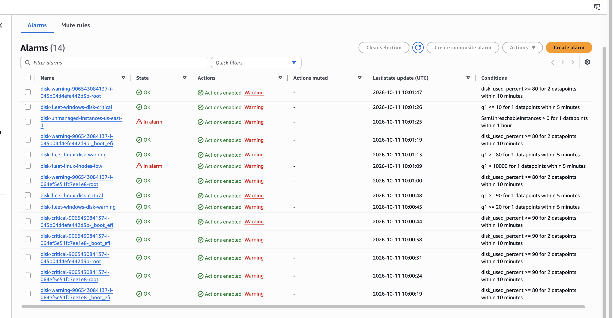

# Scalable Disk Monitoring for AWS (multi-account)

Detects low disk space early across every EC2 instance in every AWS account of an
organization — built on the existing **Ansible** stack, with **CloudWatch** added only
where it brings a clear benefit (continuous collection and alerting), and **Terraform**
for the cloud plumbing.

> **Design in one line:** Terraform builds the plumbing, Ansible enrolls and manages the VMs,
> the CloudWatch agent collects continuously, and one monitoring account sees everything.

Why not Ansible alone? Polling `df` with Ansible is a point-in-time snapshot — a disk that
fills at 3 a.m. between runs is missed, and polling thousands of VMs every minute does not
scale. So Ansible does what it is best at (discovery, enrollment, configuration, audits,
remediation) and the agent does the continuous watching. The pure-Ansible path is still
included (`50_audit_disk.yml`) as an on-demand audit and to show the pipeline end to end
without any agent.

### Why AWS
AWS is the provider chosen for this design, and it has native building blocks for every
hard part of the brief, so very little custom code is needed:
- **Organizations + service-managed StackSets** put the access role and metrics link into
  every account automatically, including accounts that join after an acquisition.
- **SSM Session Manager** is a supported Ansible connection (`amazon.aws.aws_ssm`), which
  removes SSH keys, bastions and inbound ports from the design entirely.
- **CloudWatch cross-account observability** lets one monitoring account query and alarm on
  every account's metrics without copying them.

---

## Architecture



**Flow:** Terraform deploys the hub and a StackSet → the StackSet puts a role and a metrics
link into every account (including accounts that join later) → Ansible discovers accounts
and VMs, makes them reachable over SSM, and enrolls them → the agent ships metrics → the
monitoring account alarms on all of them with one query per region.

---

## How the solution answers the brief

| Requirement | How it is met | Where |
|---|---|---|
| **Securely manage VMs across accounts** | One identity (control-node role) assumes a least-privilege role in each account; short-lived STS sessions only, no access keys; SCP stops workload admins from weakening it | `terraform/hub.tf`, `cloudformation/member-baseline.yml`, `terraform/policies/` |
| **Ansible connects reliably and securely** | `amazon.aws.aws_ssm` connection: Session Manager, **no SSH, no keys, no inbound ports, no bastion**; sessions logged by CloudTrail | `playbooks/templates/aws_ec2.yml.j2` |
| **Gather disk usage from all VMs** | CloudWatch agent (Linux + Windows), installed and configured by Ansible; on-demand pure-Ansible audit as well | `roles/cw_agent`, `roles/disk_audit` |
| **Centralize and present** | CloudWatch cross-account observability → one dashboard and alarm set in the monitoring account; consolidated CSV/HTML audit report in S3 | `roles/cw_central`, `roles/disk_audit` |
| **Handle growth** | StackSet auto-deployment for new accounts; Organizations-driven inventory; State Manager auto-enrolls new VMs; query-based alarms need no per-VM setup | see [Scalability](#scalability) |

---

## Key components

### Access management
- **Control node** — a private EC2 instance in the monitoring account (no public IP, no SSH;
  operators reach it with Session Manager). Its role can only `sts:AssumeRole` into
  `DiskMonitoringAnsibleRole` in accounts **of this organization** (`aws:ResourceOrgID`).
- **Per-account role chain** — `00_discover.yml` writes one AWS profile per account
  (`dm-<account-id>`) that assumes the member role with the instance's own credentials.
  Inventory, SSM sessions and API calls all use it. Nothing long-lived exists anywhere.
- **Member role (least privilege)** — EC2 describe, attach *only* the monitoring instance
  profile, attach *only* the two AWS-managed agent policies to existing roles
  (`iam:PolicyARN` condition), Session Manager, the agent's Parameter Store entries, the
  self-healing document/association, and the transfer bucket. Nothing else.
- **Instance permissions** — instances without a profile get `DiskMonitoringInstanceProfile`;
  instances with their own role keep it and get `AmazonSSMManagedInstanceCore` +
  `CloudWatchAgentServerPolicy` added (no replacing application roles).
- **Guardrail SCP** — denies changes to the monitoring roles, metrics links, agent config
  parameters and self-healing document by anyone except StackSets / the Ansible role.

### VM discovery and enrollment
- **Accounts** come from AWS Organizations (`DiskMonitoringOrgReader`), optionally scoped to
  OUs, with an exclusion list. A static list is supported for a PoC.
- **VMs** come from the `amazon.aws.aws_ec2` dynamic inventory, one source per account, all
  regions in scope. Hosts are grouped automatically: `acct_<id>`, `region_<r>`,
  `env_<Environment tag>`, `os_linux` / `os_windows`. Owners opt out with
  `DiskMonitoring=disabled`.
- **Enrollment** (`30_enroll.yml`) installs the agent from the regional S3 endpoint
  (reachable via an S3 gateway endpoint in private subnets), renders the config, reloads
  only on change, and **verifies** the agent is running. Golden-AMI instances that already
  have the agent are just configured.
- **Auto-enrollment and self-healing** (`20_fleet_config.yml`) — a State Manager
  association targets *all* managed instances: it installs the agent if missing and
  configures it from Parameter Store if it is not running. It applies to new instances as
  soon as they register with SSM, so VMs launched tomorrow are enrolled with no Ansible run.

### Data collection
- **Linux:** `disk_used_percent`, `disk_inodes_free` per mount; pseudo filesystems
  (tmpfs, overlay, squashfs…) and the EFI partition (`vfat`) excluded; aggregated on `InstanceId, path`.
- **Windows:** `LogicalDisk % Free Space` per volume, aggregated on `InstanceId, instance`.
- **One source of truth:** the same template renders the on-disk config (Ansible) and the
  Parameter Store copy (golden AMIs and self-healing), so all paths converge.

### Aggregation and presentation
- **Cross-account observability** — each member account links to a per-region sink in the
  monitoring account. Metrics stay in place (no copying, no extra storage cost).
- **Fleet alarms** — Metrics Insights queries, e.g.
  `SELECT MAX(disk_used_percent) FROM SCHEMA(CWAgent, InstanceId, path)`. One alarm covers
  every VM in every linked account in the region. Warning 80 %, critical 90 %, low inodes,
  Windows equivalents. For very large regions, `fleet_alarm_scope: account` adds
  `WHERE AWS.AccountId = '<id>'` and creates one alarm per account (see [limits](#limits-to-know)).
- **Per-instance alarms** — named `disk-<level>-<account>-<instance>-<mount>` so the page says
  exactly which host and path. Built from Ansible's mount facts; cross-account via
  `AccountId` in the metric query.
- **Blind-spot alarm** — `10_access.yml` publishes how many in-scope instances SSM cannot
  reach (`DiskMonitoring/SsmUnreachableInstances`, per region); `disk-unmanaged-instances-<region>`
  alarms when it is above 0, because an unreachable VM is a VM nobody is monitoring.
- **Alarm hygiene** — every `40_central_monitoring` run deletes alarms for terminated or
  opted-out instances, removed mounts, accounts that left scope, and fleet alarms from an old
  scope. Accounts whose inventory came back empty are never pruned (`prune_stale_alarms`).
- **Dashboard** — top-20 fullest filesystems/volumes per region (grouped by account,
  instance, path), fleet trend, per-account view, and live alarm status.
- **Notifications** — SNS (KMS-encrypted) per region → email; Slack, PagerDuty or Jira can
  subscribe to the same topic.
- **Audit report** — `50_audit_disk.yml` produces a consolidated CSV + HTML (sorted worst
  first, with hosts that did not report) and stores it in S3.

---

## Repository layout

```
terraform/                       Cloud plumbing (run once, then on change)
  hub.tf                           OAM sinks, SNS + KMS, S3 buckets, control-node role
  org.tf                           StackSet + per-region instances, SCP, org-reader role
  policies/scp-protect-disk-monitoring.json
  terraform.tfvars.example
  single_account.tf                TEST MODE: member baseline as a plain stack (single_account_mode)
  single-account.tfvars.example
cloudformation/
  member-baseline.yml              Member-account template (deployed BY Terraform as a StackSet)
inventory/
  hosts.yml                        localhost only; EC2 sources are generated
  group_vars/all/main.yml          all settings: regions, thresholds, names
  group_vars/os_linux.yml / os_windows.yml
playbooks/
  00_discover.yml                  accounts -> AWS profiles + per-account inventory
  10_access.yml                    SSM reachability + agent permissions + unreachable count
  20_fleet_config.yml              Parameter Store config + self-healing association
  30_enroll.yml                    install / configure / verify the agent
  40_central_monitoring.yml        fleet, per-instance + blind-spot alarms, prune, dashboard
  50_audit_disk.yml                pure-Ansible collection -> CSV/HTML report
  90_simulate_disk_pressure.yml    demo: fill a disk, watch the alarm fire
  site.yml                         00 -> 40 in order
roles/
  instance_access  cw_agent  ssm_selfheal  cw_central  disk_audit
test/                            Single-account test mode (not part of the production design)
  single-account.yml               extra vars: -e @test/single-account.yml
  launch_test_instances.yml        launch / terminate two t3.micro test instances
  create_s3_buckets.sh             create + secure the buckets via CLI (manage_s3_buckets = false)
docs/screenshots/                Evidence from the single-account test run
```

---

## Deploy

### Prerequisites
- AWS Organizations with all features; a **monitoring account**; StackSets trusted access
  enabled (or a delegated administrator).
- Terraform ≥ 1.6 with AWS provider ≥ 6.0 (uses per-resource `region`).
- Control node: Python 3.10+, the
  [Session Manager plugin](https://docs.aws.amazon.com/systems-manager/latest/userguide/session-manager-working-with-install-plugin.html),
  and `pip install -r requirements.txt && ansible-galaxy collection install -r requirements.yml`.
- Workload subnets reach SSM (`ssm`, `ssmmessages`, `ec2messages`), `monitoring`, `logs`
  and S3 — via NAT or VPC endpoints.

### 1. Cloud plumbing (Terraform)
```bash
cd terraform
cp terraform.tfvars.example terraform.tfvars    # regions, OUs, org admin role, alert email
terraform init && terraform apply               # credentials for the MONITORING account
terraform output -raw ansible_group_vars        # paste into inventory/group_vars/all/main.yml
```
Terraform creates the hub resources directly and, through the management account (or
delegated admin), the StackSet with one instance per region so each region's link points at
that region's sink.

### 2. Control node
Launch a small EC2 instance in a private subnet of the monitoring account with the
`DiskMonitoringControlNode` instance profile (Terraform output), clone this repo, install
the prerequisites above.

### 3. Run
```bash
ansible-playbook playbooks/site.yml             # discover -> access -> config -> enroll -> alarms
ansible-playbook playbooks/50_audit_disk.yml    # on-demand fleet report
```
Run `site.yml` on a schedule (AWX/AAP or cron, e.g. daily). Every step is idempotent.
Useful limits: `-l acct_<id>`, `-l env_prod`, `-l os_windows`, `-e enroll_batch=25%`.

### Minimal working demo
```bash
ansible-playbook playbooks/site.yml -l localhost,acct_<test-account>
ansible-playbook playbooks/90_simulate_disk_pressure.yml -e target=<instance-id>   # fill / to 93 %
# ~10 min: disk-fleet-linux-disk-critical + the per-instance alarm fire, email arrives,
# the instance tops the dashboard's "Top 20" widget.
ansible-playbook playbooks/50_audit_disk.yml -l localhost,<instance-id>            # shows CRITICAL
ansible-playbook playbooks/90_simulate_disk_pressure.yml -e target=<instance-id> -e fill_state=absent
```

### Testing in a single AWS account
The design above targets an organization. For a test with **one standalone account** (no
Organization), test mode makes that account both the monitoring account and the only
workload account. The multi-account code path is unchanged; test mode only switches off
what needs more than one account.

| Exercised in test mode | Not exercised (needs an Organization / second account) |
|---|---|
| EC2 discovery, role chain, SSM connection (no SSH) | OAM cross-account metrics |
| Instance profile attach, agent install + verify, self-healing association | StackSet auto-deployment to new accounts |
| Fleet, per-instance and blind-spot alarms, pruning, dashboard, email | SCP guardrail |
| Disk-pressure demo and the audit report | Account discovery from Organizations (uses `static_accounts`) |

What changes in test mode: Terraform skips `org.tf`, the OAM sinks and the org conditions,
and deploys `member-baseline.yml` as a normal stack without the metrics link
(`terraform/single_account.tf`). Ansible keeps fleet alarms region-scoped, drops
`AWS.AccountId` from dashboard queries, and alarms on local metrics without `AccountId`.

Run it from a laptop (Session Manager plugin + prerequisites installed):
```bash
# 1. Plumbing: copy and edit (account principal, email), then apply
cd terraform && cp single-account.tfvars.example single-account.tfvars
terraform init && terraform apply -var-file=single-account.tfvars && cd ..

# 2. Settings: put your account ID and AWS CLI profile in test/single-account.yml
export AWS_PROFILE=<same profile>           # used for the monitoring-account calls

# 3. Two small instances without an instance profile (10_access must attach one)
ansible-playbook test/launch_test_instances.yml -e @test/single-account.yml

# 4. Full pipeline, then the demo from the previous section with -e @test/single-account.yml
ansible-playbook playbooks/site.yml -e @test/single-account.yml
ansible-playbook playbooks/90_simulate_disk_pressure.yml -e @test/single-account.yml -e target=<instance-id>
ansible-playbook playbooks/50_audit_disk.yml -e @test/single-account.yml

# 5. Clean up
ansible-playbook playbooks/90_simulate_disk_pressure.yml -e @test/single-account.yml -e target=<instance-id> -e fill_state=absent
ansible-playbook test/launch_test_instances.yml -e @test/single-account.yml -e test_state=absent
cd terraform && terraform destroy -var-file=single-account.tfvars
```
**Behind a corporate TLS-inspecting proxy?** If Terraform fails on S3 with
`SignatureDoesNotMatch` (or a bare `403` on `HeadBucket`) while the AWS CLI works, the proxy is
rewriting a header the Go SDK signs for S3 (`Accept-Encoding`). Set `manage_s3_buckets = false`
in `single-account.tfvars`, run `terraform apply`, then `test/create_s3_buckets.sh`, which
creates both buckets with the same encryption, lifecycle, policy and public-access settings.
Ansible uses boto3, which does not sign that header, so it should not be affected.

Cost for a one-day test: a few dollars (two `t3.micro`, a few dozen metrics and alarms,
prorated hourly). The reports bucket is versioned; empty it before `terraform destroy`.

---

## Scalability

| Growth event | What happens | Manual work |
|---|---|---|
| New or acquired account joins a target OU | StackSet auto-deployment creates role + metrics links; next `00_discover` adds profile + inventory | none |
| Account leaves / is closed | StackSet removes its stacks; `00_discover` deletes its inventory source | none |
| New VM launched | State Manager association enrolls it when it registers with SSM; fleet alarms cover it at its first datapoint | none |
| New region | Add it to `regions` (Terraform) and `aws_regions` (Ansible) | one variable each |
| Thousands of VMs | `forks=50`, `strategy: free`, `serial` batches, fact + inventory caching; move to AWX/AAP execution environments for parallel per-OU jobs | tuning only |
| More than ~2,500 VMs in one region | Set `fleet_alarm_scope: account` (one query per account); the run warns before this point | one variable |
| VM terminated | Its per-instance alarms are deleted on the next `40_central_monitoring` run | none |

Alarm count does **not** grow with the fleet for fleet alarms (one query per region).
Per-instance alarms scale linearly and can be disabled with `per_instance_alarms: false`.
Custom-metric cost is controlled by keeping dimensions to `InstanceId + path`.

### Limits to know
From the [CloudWatch Metrics Insights quotas](https://docs.aws.amazon.com/AmazonCloudWatch/latest/monitoring/cloudwatch-metrics-insights-limits.html):
- **One query processes at most 10,000 metrics.** Past that it silently uses the first
  10,000 it finds, so a fleet alarm could miss filesystems. With ~4 filesystems per VM that
  is ~2,500 VMs per region. `40_central_monitoring` estimates this per scope and warns.
  `fleet_alarm_scope: account` splits each query per account.
- **200 Metrics Insights alarms per region.** With 5 fleet rules, account scope covers up to
  40 accounts per region; beyond that, request a quota increase or drop the warning-level
  fleet rules (per-instance alarms still give warnings).
- Per-instance alarms are standard metric alarms and are not affected by either limit.

---

## Cost (estimate)

CloudWatch is the only meaningful cost. These are us-east-1 list prices from the
[CloudWatch pricing page](https://aws.amazon.com/cloudwatch/pricing/); check current prices
before relying on them. Example: **1,000 Linux VMs, 3 filesystems each**.

| Item | Pricing | Quantity | Monthly |
|---|---|---|---|
| Custom metrics (`disk_used_percent`, `disk_inodes_free` per filesystem) | $0.30 per metric (first 10k) | 6,000 | ~$1,800 |
| Per-instance alarms (warning + critical per filesystem) | $0.10 per alarm metric | 6,000 | ~$600 |
| Fleet Metrics Insights alarms (billed **per metric analyzed**) | $0.10 per analyzed metric | 3 rules × 3,000 | ~$900 |
| Dashboard, SNS, KMS keys, S3 | — | — | < $20 |
| Cross-account observability, Session Manager, State Manager on EC2 | no charge | — | $0 |
| **Total** | | | **~$3,300 (≈ $3.30 per VM)** |

Ways to reduce it: collect `inodes_free` only where inode exhaustion is a real risk
(−$900 metrics, −$300 fleet alarm), keep only critical per-instance alarms (−$300), or
turn off per-instance alarms where the fleet alarm plus the dashboard is enough
(−$600). The pure-Ansible audit (`50_audit_disk.yml`) costs nothing in AWS, but it only
sees disk usage at the moment it runs, which is why it is the fallback and not the primary
detector.

---

## Security summary
- No SSH, no inbound ports, no bastion, no static credentials; all access is short-lived STS.
- Trust chain is closed: member roles trust only the control-node role; the control node can
  only reach roles inside the organization.
- Least-privilege roles with resource and condition scoping (`iam:PassedToService`,
  `iam:PolicyARN`, `aws:PrincipalOrgID`).
- KMS on both buckets and every alerts topic; TLS-only bucket policies; transfer objects
  expire after 1 day.
- SCP protects the monitoring plumbing from tampering inside workload accounts.
- Audit trail: CloudTrail (STS, SSM sessions, API calls), Ansible run logs, S3 versioning.

---

## Testing performed

**All live testing was done in a single standalone AWS account** using
[single-account test mode](#testing-in-a-single-aws-account): `us-east-1`, two `t3.micro`
Amazon Linux 2023 instances, Ansible run from a laptop. The multi-account pieces (StackSet,
OAM cross-account metrics, Organizations discovery, SCP) were **not** exercised live; see
[Not tested live](#not-tested-live).

### Static checks
| Check | Result |
|---|---|
| `ansible-lint` (production profile) | pass: 0 failures, 0 warnings, 53 files |
| `ansible-playbook --syntax-check` (all playbooks) | pass |
| Offline logic test of `cw_central` with fake hosts and alarms (both modes) | pass: alarm scopes, alarm names, all prune rules, `account_id` handling, dashboard queries |
| `terraform plan` / `apply` (Terraform 1.16, AWS provider 6.56, recorded in `.terraform.lock.hcl`) | pass in single-account mode (with `manage_s3_buckets = false`, see environment notes); org mode not applied |
| `cfn-lint` on the member template | passed before the test-mode changes; not re-run since (the stack itself deployed successfully) |

### Live test in one AWS account
| Step | Result |
|---|---|
| `terraform apply` | KMS keys, SNS topic, control-node role and the member baseline stack (Ansible role + instance profile) created; no Organization, StackSet or OAM resources |
| `00_discover` | 1 account × 1 region, 2 running instances discovered |
| `10_access` | instance profile attached to both instances (they had none); after SSM registration: **reachable 2, unreachable 0**; re-run reported **0 changes** |
| `20_fleet_config` | agent configs in Parameter Store, self-healing document and association created |
| `30_enroll` | CloudWatch agent configured and verified running on both instances **over Session Manager, no SSH** |
| `40_central_monitoring` | 5 fleet alarms, warning + critical alarm per instance and filesystem, blind-spot alarm, dashboard |
| Dashboard | live `CWAgent` data from both instances, labelled by instance, Name tag and mount path |
| **Disk-pressure demo** (`90_simulate_disk_pressure`, `/` on `dm-test-1` filled to 93 %) | `disk-fleet-linux-disk-critical` went **OK → In alarm** at 10:15 UTC (query value **93.0 %** vs threshold 90); the named per-instance alarms `disk-critical-…-i-064ef5e51fc7ee1e8-root` and `disk-warning-…-root` fired; the other instance's alarms stayed **OK** |

| | |
|---|---|
|  |  |
| Test instances running, CloudWatch agent metrics enabled | Fleet dashboard: Top 20 filesystems, trend, per-instance view |

| | |
|---|---|
|  |  |
| Both instances managed by SSM (Online), reached without SSH | Disk-pressure demo: fleet critical alarm at 93 %, per-instance critical + warning alarms in ALARM |

More: [only the full host alarmed](docs/screenshots/06b-alarm-only-full-host.png).


*Alarms after the first run: 14 created. The two in ALARM are the bugs listed below.*

### Issues the live test found, and the fixes
| Issue | Cause | Fix |
|---|---|---|
| `disk-fleet-linux-inodes-low` alarmed on healthy hosts | `/boot/efi` is FAT (`vfat`), which has no inodes, so it reports `inodes_free = 0` | `vfat` added to `cw_ignore_fstypes` (agent, alarms and audit share the list); prune removes the old `/boot/efi` alarms |
| `disk-unmanaged-instances-<region>` stayed in ALARM after the instances became reachable | 1-hour `Maximum` kept an earlier "2 unreachable" datapoint | 5-minute period with `treat_missing_data: ignore`, so the alarm follows the latest run |
| Instances unreachable right after the profile was attached | the SSM agent picks up a new instance profile only on its next retry (minutes) | expected; `10_access` reports them and later plays skip them. Rebooting the instances makes them register immediately |
| Deprecation warnings (`tags` hostvar, injected cached fact) | `amazon.aws` 11.x and `ansible-core` 2.19+ deprecations | `use_deprecated_tags: false` in the inventory template; account list no longer cached as a fact |

The first two fixes were made after the disk-pressure demo and have **not been re-run live**; the next `site.yml` run applies them (prune deletes the four `/boot/efi` alarms). The pure-Ansible audit (`50_audit_disk.yml`) was not run in this live test.

**Environment notes (corporate Mac, not product issues):** a TLS-inspecting proxy rewrote a
header that the Terraform provider signs for S3 (`SignatureDoesNotMatch`), worked around with
`manage_s3_buckets = false` + `test/create_s3_buckets.sh`; Python needed the macOS CA bundle
(`SSL_CERT_FILE`, `AWS_CA_BUNDLE`); macOS fork safety needed
`OBJC_DISABLE_INITIALIZE_FORK_SAFETY=YES` and `no_proxy='*'`; the Session Manager plugin was
installed per user (no sudo). None of these apply on a Linux control node in AWS.

### Not tested live
These run only with an Organization and more than one account, and were validated only
against AWS documentation and the emulator run below:
- StackSet auto-deployment of the member baseline to target OUs
- OAM sink/link cross-account metrics, and fleet alarms / dashboard queries using `AWS.AccountId`
- Per-instance alarms reading another account's metrics (`account_id`)
- Cross-account access to the hub SSM-transfer bucket and its KMS key
- Organizations account discovery and the protective SCP

### Earlier emulator run (multi-account)
Before the live test, the multi-account flow was run against a local AWS emulator (moto):
3-account org, 2 regions, 21 VMs. Discovery found all accounts and 15 of 21 VMs (6 opted
out); access attached profiles and agent policies; configs and the self-healing document
landed in all 6 account/regions; fleet alarms, per-instance alarms and the dashboard were
created; the audit flagged a 96 %-full filesystem as CRITICAL. Re-runs reported zero changes.
The emulator could not run SSM sessions or evaluate cross-account alarms.

---

## Trade-offs and next steps
- **SSM dependency:** instances without a working SSM agent can't be managed. They are
  reported by `10_access.yml` and raise `disk-unmanaged-instances-<region>`, but still need
  a manual fix (AMI with the agent, VPC endpoints).
- **Pipeline freshness:** the blind-spot alarm keeps its last state between runs; if the
  scheduled `site.yml` itself stops running, nothing alerts. Add a heartbeat (AWX job
  failure notifications, or a metric published at the end of `site.yml`).
- **Remediation:** add a `remediate_disk.yml` (log rotation, cache cleanup, EBS grow via
  `modify-volume` + `growpart`) triggerable from the critical alarm.
- **Prediction:** CloudWatch anomaly detection or a "days until full" forecast for earlier
  warning.
- **Other clouds:** the same pattern maps to Azure (Lighthouse + Arc + Azure Monitor Agent)
  and GCP (Ops Agent + metrics scopes).
